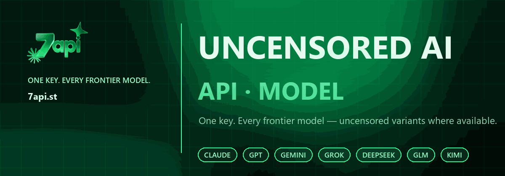

# 7API

**One API key for frontier and open-weight AI models — including uncensored and abliterated variants where available.**

---

## Start here

| Repository | What it covers |
|---|---|
| **[uncensored-ai-api](https://github.com/7API/uncensored-ai-api)** | Uncensored AI API or model access — one key for Claude, GPT, Gemini, Grok, DeepSeek, GLM and Kimi. |
| **[glm-5.3-abliterated](https://github.com/7API/glm-5.3-abliterated)** | GLM 5.3 abliterated or uncensored — 35 jailbreak prompts, model guide and API setup. |
| **[ai-jailbreaks](https://github.com/Alejandros17487/ai-jailbreaks)** | 35 paste-ready system prompts and agent specs for AI research. |

## Why 7API

- **One key, every family** — Claude, GPT, Gemini, Grok, DeepSeek, GLM and Kimi.
- **Compatible** — OpenAI SDK, Anthropic SDK, Claude Code, Cursor, Codex CLI and OpenCode.
- **Uncensored options** — select uncensored and abliterated variants.
- **Pay per token** — no subscription; prompt caching and crypto top-ups.
- **Built for teams** — subkeys, usage tracking and referrals.

## Quick links

[Get an API key](https://7api.st/?utm_source=github&utm_medium=org&utm_campaign=7api) · [Telegram](https://t.me/seven_api) · [Uncensored AI API guide](https://github.com/7API/uncensored-ai-api) · [GLM 5.3 abliterated guide](https://github.com/7API/glm-5.3-abliterated)

---

7API is an independent API gateway. Model names and trademarks belong to their respective owners. Use responsibly and follow the terms that apply to you.

